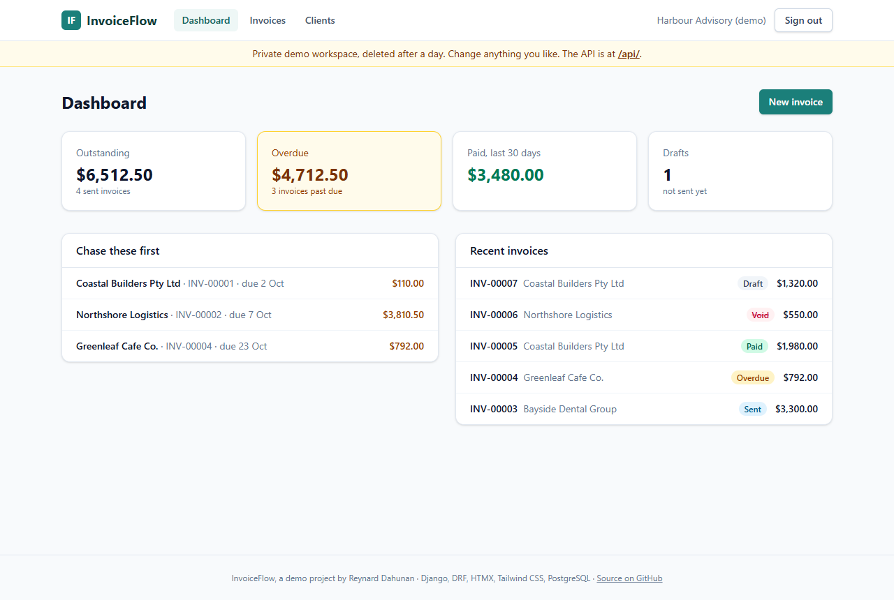
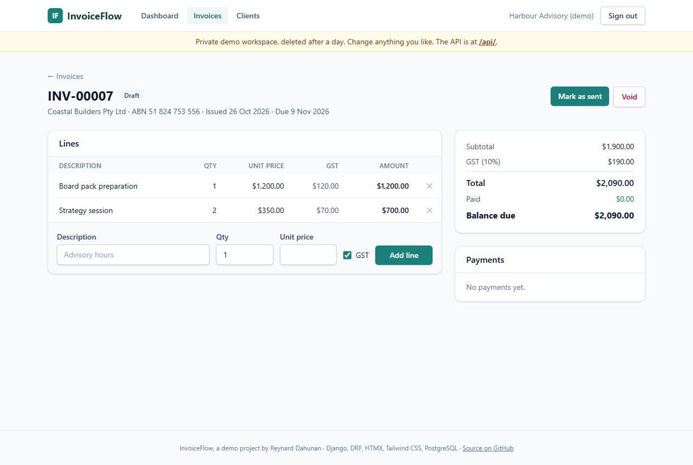
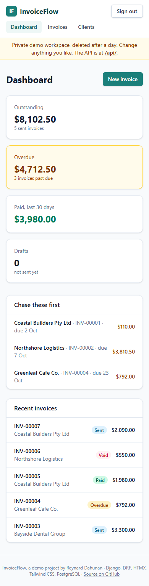

# InvoiceFlow

[](https://github.com/rdahunanitservices/invoiceflow/actions/workflows/ci.yml)

Invoicing for Australian consultancies: clients with ABNs, invoices with 10% GST,
payments, and overdue tracking.

**Live demo: [rdahunan-invoiceflow.vercel.app](https://rdahunan-invoiceflow.vercel.app)**. Click *Try the live demo* to get a private
workspace with sample data. There's no sign-up, and it's deleted after a day.

Django 6.1 · Django REST Framework · HTMX · Tailwind CSS · PostgreSQL ·
pytest · GitHub Actions · Vercel

| Dashboard | Invoice | Phone |
|---|---|---|
|  |  |  |

## What it does

- **Clients** with ABN checksum validation and payment terms.
- **Invoices**: draft → sent → paid (or void). Numbered per organisation
  (`INV-00001`), with lines, 10% GST per taxable line, and GST-free lines.
- **Payments**: part or full. An invoice becomes *Paid* when the balance reaches
  zero, and overpayments are refused.
- **Dashboard**: outstanding, overdue, paid in the last 30 days, and the
  invoices to chase first.
- **REST API** for everything above, with token auth and a browsable UI.

## Design decisions

**Every record belongs to an organisation, and every query starts there.**
Views and the API begin with `Model.objects.for_org(org)` and fetch single
records with `get_object_or_404` on that scoped queryset. Another organisation's
invoice is a 404, not a 403, so ids reveal nothing. Form and serializer choice
fields are scoped the same way, so posting another organisation's client id fails
validation. There are tests for each of these paths.

**Business rules live in one place.** [`billing/services.py`](billing/services.py)
holds the rules (numbering, GST, sending, payments, voiding). The HTML views and
the API both call it, so they can't drift apart. Totals are kept by the service
and are read-only everywhere else, including the admin.

**Money is `Decimal`, rounded per line.** Each line's amount and GST are rounded
half-up to the cent, and the invoice totals are the sums.
`3 × $33.33 = $99.99`, GST `$10.00`.

**No races on numbers or payments.** Invoice numbers come from a per-organisation
counter locked with `SELECT … FOR UPDATE`. Payments lock the invoice before
checking the balance. A test creates 16 invoices from 8 threads against
PostgreSQL and checks the numbers are exactly 1-16. That test fails if the lock
is removed.

**The database backs up the rules.** Unique invoice numbers per organisation,
due date on or after issue date, positive quantities and payments, and
`amount_paid <= total` are all `CheckConstraint`s or `UniqueConstraint`s.

**HTMX, kept simple.** Each action on the invoice page returns one partial
(`billing/partials/invoice_body.html`) that replaces the page body. Validation
errors come back as `422`, and htmx is configured to render them in place. Every
form also has a normal `action`, so it still works without JavaScript.

**Secure by default.** Settings come only from environment variables, and the
app refuses to start with DEBUG off unless it has a secret key and a database
URL. CI runs `manage.py check --deploy --fail-level WARNING`, so HSTS, secure
cookies, and the SSL redirect are checked on every push. The API token endpoint
is throttled. The health check never returns error details.

## API

The API is browsable at `/api/`, and demo users are already signed in.

```bash
# Get a token
curl -X POST https://rdahunan-invoiceflow.vercel.app/api/auth/token/ -d username=you -d password=...

# Create an invoice with its lines in one request
curl -X POST https://rdahunan-invoiceflow.vercel.app/api/invoices/ \
  -H "Authorization: Token $TOKEN" -H "Content-Type: application/json" \
  -d '{"client": 1, "lines": [
        {"description": "Advisory hours", "quantity": "7.5", "unit_price": "180.00"},
        {"description": "Travel", "quantity": "1", "unit_price": "85.50", "taxable": false}]}'

# Send it, then record a payment
curl -X POST https://rdahunan-invoiceflow.vercel.app/api/invoices/42/send/ -H "Authorization: Token $TOKEN"
curl -X POST https://rdahunan-invoiceflow.vercel.app/api/invoices/42/payments/ -H "Authorization: Token $TOKEN" \
  -d amount=500.00 -d reference="EFT 1234"

# Overdue invoices
curl "https://rdahunan-invoiceflow.vercel.app/api/invoices/?status=overdue" -H "Authorization: Token $TOKEN"
```

Business-rule errors are `400` responses with a readable message, for example
`{"detail": ["Payment is more than the balance owing ($1,100.00)."]}`.

## Run it locally

Requirements: Python 3.12+, [uv](https://docs.astral.sh/uv/), Docker.

```bash
docker compose up -d          # PostgreSQL on localhost:5433
cp .env.example .env
uv sync
uv run python manage.py migrate
uv run python manage.py runserver
```

Open http://localhost:8000 and click *Try the live demo*, or create a user with
`createsuperuser` and link it to an organisation in `/admin/`.

## Tests and CI

```bash
uv run pytest                 # 103 tests, about 10 seconds, against PostgreSQL
uv run ruff check . && uv run ruff format --check .
```

GitHub Actions runs on every push and pull request:
- **Code checks:** lint and format.
- **Migrations:** a check that none are missing.
- **Deploy checks:** Django's production checks.
- **Tests:** the full suite against a real PostgreSQL service.
- **Styles:** a check that the committed Tailwind build matches the templates.

## Deploying

The live demo runs on Vercel (Django support with no extra config, in the Sydney
region) with a Neon PostgreSQL database. The build step runs migrations, and
Vercel collects the static files and serves them from its CDN. Required
environment variables: `DJANGO_SECRET_KEY` and `DATABASE_URL`. Vercel's own
hostname variables are added to `ALLOWED_HOSTS` automatically.

## How it was built

Built with [Claude Code](https://claude.com/claude-code), following the rules in
[`AGENTS.md`](AGENTS.md): plan before building, one feature per pull request,
tests with every change, and a review of every diff before merging. The pull
requests show the steps in order: scaffold → billing domain → HTMX UI →
REST API → demo and deploy.

Made by Reynard Dahunan · [rdahunanitservices.com](https://rdahunanitservices.com)
